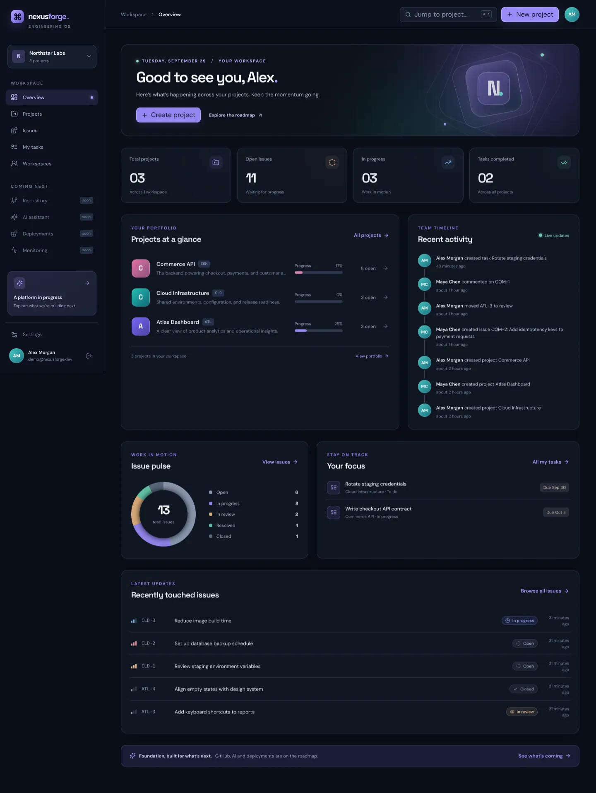
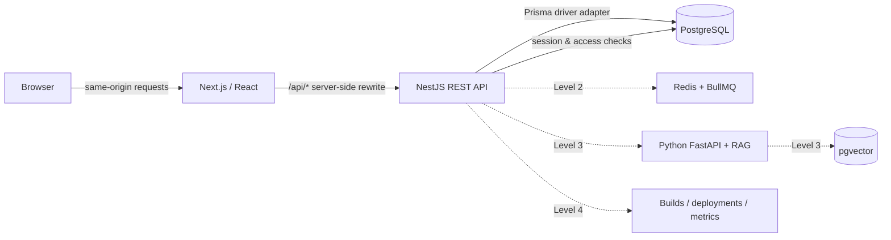
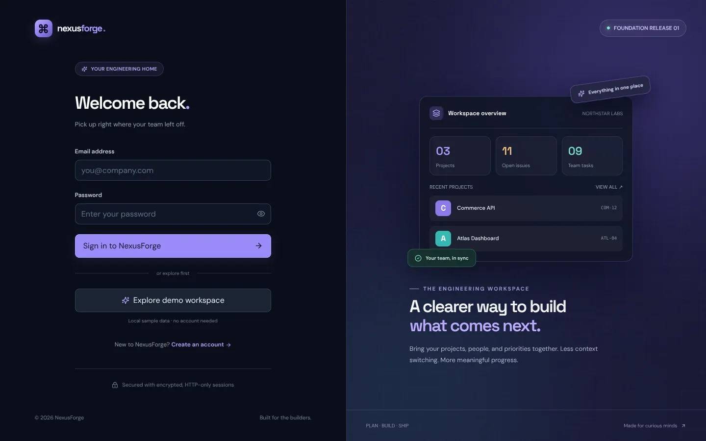
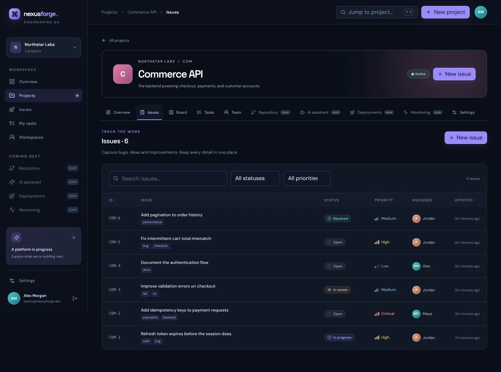
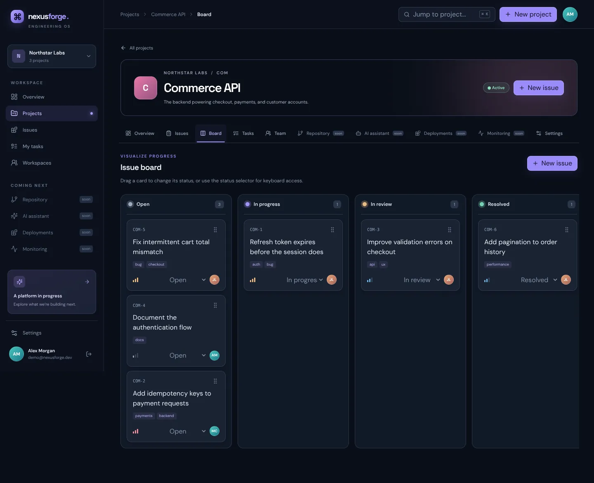

# NexusForge

**Intelligent Cloud-Native Web Engineering Platform**

A focused home for the people, projects, issues and tasks behind great software.

> **Current release: Level 1 — Foundation.** This repository implements the working project-management foundation. GitHub integration, Redis/queues, document ingestion, RAG, deployments and full monitoring are **planned**, not simulated or advertised as complete.



## Overview

NexusForge brings a team's work into one workspace: create projects, grant access, track issues on a Kanban board, assign tasks and see real activity and progress. It is designed to grow in stages toward repository-aware engineering, AI assistance and cloud operations—without starting with the most complicated layer.

### The problem → the solution

Engineering context gets scattered across issue trackers, spreadsheets, repositories and chat. NexusForge starts with a secure shared source of truth for projects and work. Later milestones will connect code and documentation to that context.

## What's working today

- **Accounts:** register, login, logout, rotating refresh sessions, profile editing and password changes.
- **Workspaces & teams:** create and rename workspaces; add existing registered users; owner/admin/developer/viewer roles.
- **Projects:** create, update, archive and delete projects; project-specific role overrides.
- **Issues:** numbered per project, priority, status, assignee, labels, comments, filtering and deletion.
- **Kanban:** drag issues between five workflow columns, with a keyboard-accessible status selector.
- **Tasks:** create, assign, schedule, edit and complete tasks; a cross-project “My tasks” view.
- **Dashboard:** live counts, project progress, issue breakdown, assigned tasks and recent audit activity.
- **REST API:** validated NestJS endpoints, PostgreSQL persistence via Prisma and development Swagger docs.
- **Foundation health:** real API and database checks (`/api/health` and `/api/health/database`).

**Not in this release:** email verification/recovery, email invitations, attachments, GitHub OAuth/webhooks, Redis, background workers, document uploads, AI/RAG, deployments and historical monitoring. The matching screens are explicitly marked *planned*.

## Architecture



The browser never calls `localhost` for a backend service: it uses relative `/api/*` URLs and Next.js proxies them internally. The API is the sole authorization boundary. See [foundation architecture](docs/architecture/foundation.md).

## Tech stack

| Layer | Implemented in Foundation |
| --- | --- |
| Web | Next.js App Router, React 19, TypeScript, Tailwind CSS 4, Radix-based UI primitives, TanStack Query, Zod, dnd-kit |
| API | NestJS, TypeScript, REST, class-validator, Swagger/OpenAPI |
| Data | PostgreSQL, Prisma ORM 7, Prisma migrations, `@prisma/adapter-pg` |
| Auth | Argon2id, short-lived JWT access cookies, rotating opaque refresh cookies, CSRF double-submit token |
| Tooling | npm workspaces, Docker Compose foundation stack, GitHub Actions verification |

Redis, Python/FastAPI, pgvector, CI image publishing and observability belong to later levels; they are not dependencies of the Foundation runtime.

## Monorepo

```text
apps/
  web/                  Next.js frontend, routes and UI
  api/                  NestJS modules, Prisma schema/migrations, integration tests
packages/
  types/                Shared public response contracts
infrastructure/docker/ Dockerfiles for the foundation web and API
.github/workflows/       Typecheck / test / build / audit CI
docs/                   Architecture, API, database and setup notes
docker-compose.yml      Web + API + PostgreSQL for local use
```

`apps/ai`, Redis workers, Nginx and additional shared packages will be introduced when their roadmap milestones are implemented—not as non-functional scaffolding.

## Run locally

**Requirements:** Node.js 22+, npm 10+ and a running PostgreSQL 17+ instance (Docker recommended).

```bash
cp .env.example .env
cp apps/api/.env.example apps/api/.env
# Replace both ACCESS_TOKEN_SECRET and REFRESH_TOKEN_SECRET with different random 32+ character values
# in .env and apps/api/.env. Set apps/api/.env DATABASE_URL to your local database.

docker compose up -d postgres
npm ci
npm run db:generate
npm run db:migrate
npm run dev
```

Open **http://localhost:3000**. The API listens on `http://localhost:4000`; its Swagger UI is at **http://localhost:4000/api/docs** in development. If you don't have a local PostgreSQL server, use the full Compose stack instead:

```bash
cp .env.example .env
# Set two distinct, strong token secrets in .env
# (Use a long URL-safe POSTGRES_PASSWORD; the example is for local development only.)
docker compose up --build
```

The web app is at **http://localhost:3000**. Compose applies the committed Prisma migration before starting the API. Do not use this development Compose configuration as an Internet-facing production deployment; HTTPS, production secrets and network hardening belong to the deployment milestone. See [local deployment notes](docs/deployment/local.md).

### Optional demo workspace

For a local-only sample with 3 projects, 13 issues, 9 tasks and 4 users:

```bash
# Local npm setup: set DEMO_MODE=true in apps/api/.env, then:
npm run db:seed

# Full Compose setup: set DEMO_MODE=true in root .env, then:
docker compose exec api npm run db:seed
```

The login page then shows **Explore demo workspace**. The seeded account is `demo@nexusforge.dev` / `Demo123456!`. Seed is idempotent and refuses to run when `NODE_ENV=production`. Never enable demo mode in production.

## Database design

Core tables: `User`, `RefreshSession`, `Workspace`, `WorkspaceMember`, `Project`, `ProjectMember`, `Issue`, `Comment`, `Task`, `AuditLog`. Enums define roles, project states, issue status/priority and task status. Issue numbers are allocated atomically within a database transaction. More details: [schema and relationships](docs/database/foundation.md).

## API documentation

The API is prefixed with `/api`. Representative endpoints:

```text
GET  /api/auth/csrf           POST /api/auth/register
POST /api/auth/login          POST /api/auth/refresh
POST /api/auth/logout         GET  /api/auth/me
PATCH /api/users/me           PATCH /api/users/me/password
GET/POST /api/workspaces      GET/POST /api/workspaces/:id/members
GET/POST /api/projects        GET/POST /api/projects/:id/members
GET/POST /api/projects/:id/issues    PATCH /api/issues/:id
GET/POST /api/issues/:id/comments    GET/POST /api/projects/:id/tasks
PATCH /api/tasks/:id          GET  /api/dashboard
GET  /api/health              GET  /api/health/database
```

For mutating requests, first call `GET /api/auth/csrf`, retain the returned cookie, and send the returned value in `x-csrf-token`. The web client does this automatically. Full routes and access rules: [API guide](docs/api/foundation.md); live OpenAPI UI: `/api/docs` in development.

## Security

- Passwords are stored as **Argon2id hashes**, never plaintext. Access JWTs live in short-lived **HTTP-only** cookies; refresh tokens are random, hashed at rest, rotated and revocable. Logout invalidates the associated access session server-side.
- Mutations require a matching CSRF token. Cookies are SameSite=Lax and Secure when `NODE_ENV=production`. Auth routes are rate-limited; request bodies are validated and unknown fields rejected.
- **Backend RBAC:** workspace owners/admins manage teams and projects; developers work on issues/tasks; viewers are read-only. Project role overrides never bypass workspace membership, and workspace managers retain their permissions.
- Prisma parameterizes database queries. React escapes user content. Helmet adds API security headers. Demo accounts are opt-in and development-only.
- Do not commit `.env` files; the repository ignores them. Never put GitHub/OAuth/LLM credentials into source or audit labels.

Email verification, forgot-password email, file upload validation, webhook signatures and broader production hardening are **future work**, not present security claims. See [security notes](docs/architecture/foundation.md#security-boundaries).

## Testing

The Foundation integration suite exercises the real HTTP API against PostgreSQL: CSRF, registration/password hashing, sessions, workspace/project creation, non-member isolation, viewer RBAC, project role overrides, issue numbering/comments, tasks and dashboard counts.

```bash
# After migrating a local disposable database:
npm test
npm run typecheck
npm run build
npm audit --audit-level=high
```

`npm test` needs `DATABASE_URL` pointing at a migrated PostgreSQL database. CI provisions its own PostgreSQL service and runs the same checks. Playwright E2E suites, deployment tests and AI evaluation will be added with their respective levels.

## CI/CD and deployment status

**Implemented CI:** GitHub Actions installs dependencies, generates Prisma Client, applies migrations to a test database, typechecks, runs integration tests, builds both apps and audits dependencies. **Not implemented:** image publishing, automated production deploys, release promotion and rollback. The Docker Compose stack is a local development convenience, not a claim of production deployment.

## Screenshots

| Login | Project issues |
| --- | --- |
|  |  |



## Demo and next steps

There is no public hosted demo yet. Run locally and enable the optional demo seed, or register a new account. The in-app **Roadmap** page distinguishes live Foundation features from planned engineering/AI/cloud features.

See the [phased roadmap](docs/roadmap.md). Future phases: GitHub OAuth + verified webhooks → Redis/BullMQ background jobs → safe document/code indexing → pgvector retrieval + Python RAG with sources → automated CI/CD deployments, monitoring and production security review.

---

**Portfolio note:** Describe only capabilities that are implemented. GitHub/AI/deployment bullets should wait until those milestones actually ship.
