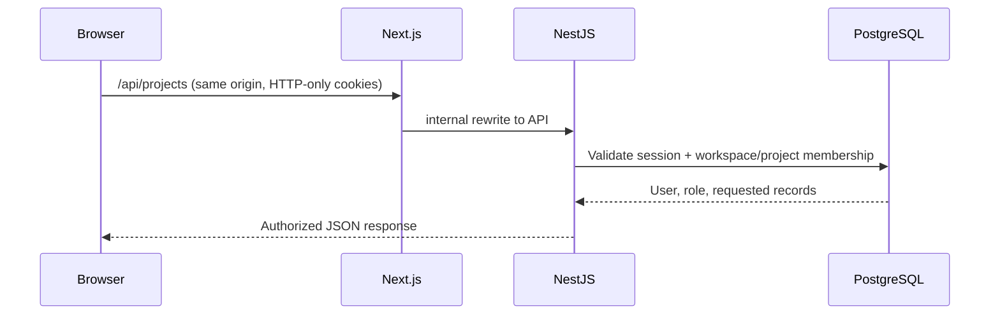

# Foundation architecture (Level 1)

## Request path

`apps/web` uses TanStack Query for server state. The browser calls only relative `/api/*` endpoints; `apps/web/next.config.ts` rewrites them to `API_INTERNAL_URL` on the server. NestJS validates DTOs globally, checks CSRF on unsafe methods and authenticates every non-public endpoint. Controllers delegate authorization to `AccessService` before services read or mutate project data.

## Identity and authorization

1. Register validates name/email/password, normalizes email and stores an Argon2id hash.
2. Login issues a 15-minute JWT access cookie containing the user and session ID, plus a random 7-day refresh cookie. The refresh token is **hashed before it is stored**.
3. The auth guard checks JWT signature/type, session revocation/expiry and user existence. Logout revokes the session, so a copied access JWT stops working immediately.
4. Refresh atomically claims the old session and rotates both cookies. Reuse of a revoked refresh token invalidates the user's active sessions.
5. An unsafe HTTP method requires `nf_csrf` and a matching `x-csrf-token`. The frontend obtains them from `/api/auth/csrf` and retries once if another tab has rotated that cookie.

Workspace membership is mandatory to see any workspace project. Workspace `OWNER`/`ADMIN` retain management permissions everywhere; other members may have a project-specific override. Owners cannot be demoted or removed through member endpoints. Only a workspace owner can grant `ADMIN`, and `OWNER` cannot be assigned through these endpoints. Assignees must be workspace members. **Hiding UI controls is not the security boundary**; the same rules are checked server-side for every route.

| Capability | Owner | Admin | Developer | Viewer |
| --- | :---: | :---: | :---: | :---: |
| View workspace, projects, issues, tasks | ✓ | ✓ | ✓ | ✓ |
| Create/edit issues, comments, tasks | ✓ | ✓ | ✓ | — |
| Create/edit projects and manage project roles | ✓ | ✓ | — | — |
| Manage workspace members | ✓ | ✓* | — | — |
| Grant admin / remove an admin | ✓ | — | — | — |
| Delete projects | ✓ | ✓** | — | — |

\* Admins cannot grant `ADMIN`, modify another admin or change the owner.

\** Only *workspace* owners/admins may delete projects; a project-specific admin cannot.

## Modules and data

- `AuthService` / `UsersService`: credentials, session rotation, identity and password changes.
- `AccessService`: central workspace/project membership and assignee rules.
- `WorkspacesService` / `ProjectsService`: team membership, project lifecycle and scoped role overrides.
- `IssuesService` / `TasksService`: work items, workflow statuses, comments and assignments.
- `DashboardService`: real aggregates from accessible projects.
- `AuditService`: action records tied to a workspace, shown in activity feeds.
- `PrismaService`: Prisma Client with PostgreSQL driver adapter.

Issue numbers use an atomic project counter increment and issue creation in the same Prisma transaction, avoiding duplicate IDs when requests arrive together. Deleting a workspace cascades project work; project deletion preserves workspace audit records with a null project reference.

## Security boundaries

- Secrets come from environment variables. Startup fails if database URL or two distinct 32+ character token secrets are missing.
- `helmet` secures API responses; CORS only allows configured `WEB_ORIGIN` for direct API clients. Next.js's same-origin proxy is preferred. Never expose the development API or demo mode as a production service.
- Validation strips nothing silently: unknown DTO fields produce 400. Lists have finite limits. Prisma uses parameterized queries. User content is rendered as text, not HTML.
- Audit events contain actor/entity/short action labels, **not** request bodies or credentials. There is no upload, webhook or repository indexing surface in this release.
- Production still needs HTTPS/reverse proxy, real mail verification/recovery, operational monitoring, secret rotation, dedicated test/production databases, backups and a deployment threat review.
