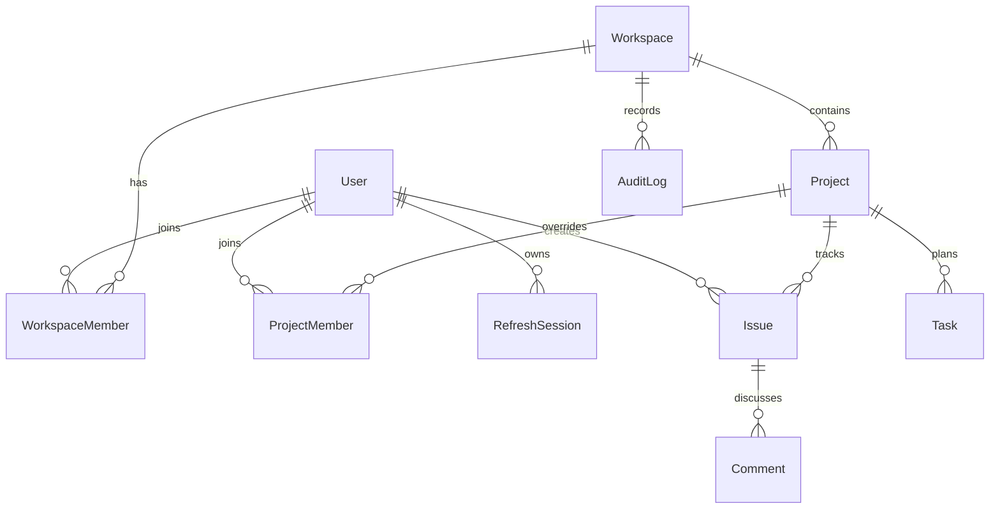

# Foundation database (PostgreSQL + Prisma)

Source of truth: [`apps/api/prisma/schema.prisma`](../../apps/api/prisma/schema.prisma). The initial SQL migration is committed under `apps/api/prisma/migrations/`; apply it with `npm run db:migrate`.



| Model | Purpose |
| --- | --- |
| `User` | Identity; unique normalized email and Argon2id password hash |
| `RefreshSession` | Hashed opaque refresh token, expiry and revocation |
| `Workspace` | Owner, name, unique slug |
| `WorkspaceMember` | Workspace-scoped role and membership; unique `(workspaceId,userId)` |
| `Project` | Workspace-scoped unique key and atomic `nextIssueNumber` |
| `ProjectMember` | Optional project-scoped role override, only for workspace members |
| `Issue` | Per-project number, priority, status, labels, creator and assignee |
| `Comment` | Issue discussion by a user |
| `Task` | Project to-do, status, optional due date and assignee |
| `AuditLog` | Actor/action/entity label for visible activity history |

The current schema intentionally has **no** document chunks, embeddings, deployments, repositories or notifications. Those models arrive with the features that use them. For Level 3, PostgreSQL + pgvector is the initial vector-storage plan; no vector queries are present today.

Local migration sequence:

```bash
npm run db:generate
npm run db:migrate
# Optional, local development only:
# DEMO_MODE=true npm run db:seed
```

The integration suite uses its own migrated database in CI and removes records it creates. Use a disposable database when running tests locally.
